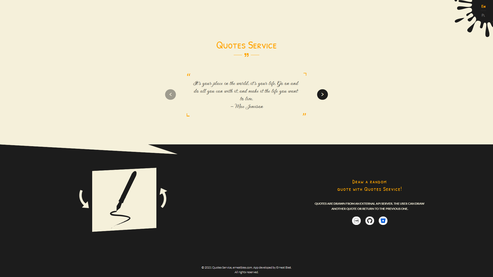

# Quotes Service

An application that downloads quotes from the API. The user can draw another quote or return to the previous one. The application was created using React, React Redux and Styled Components. The application supports Polish and English.



## Development and deployment

Use Node.js 24 (see `.nvmrc`) and Yarn Classic 1.22.22.

```sh
yarn install
npm start
```

Run `npm run deploy` to build the application and publish the `build` directory
to the `gh-pages` branch. In GitHub Pages settings, keep **Deploy from a branch**
with **gh-pages** and **/ (root)** as the publishing source.
